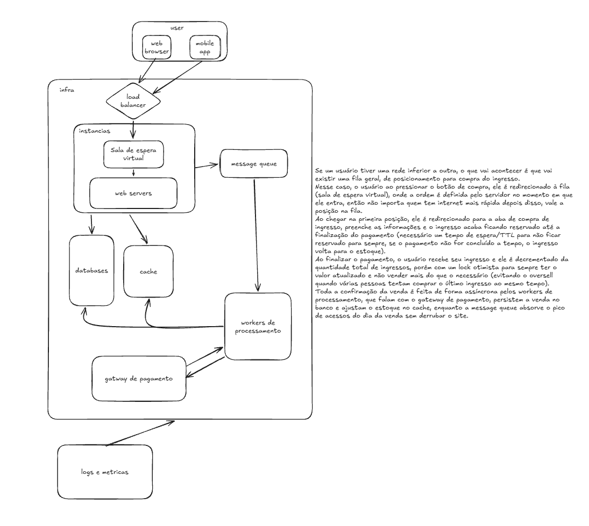

# Sistema de venda de ingressos

Arquitetura de um sistema de venda de ingressos pra um show de alta demanda (tipo Rock in Rio), onde o número de ingressos é limitado e muito menor que a quantidade de gente tentando comprar no dia da venda.

A ideia precisa resolver dois pontos:

- quem tem internet mais lenta não pode perder o ingresso pra quem tem internet mais rápida
- não pode vender mais ingresso do que realmente existe

## Como funciona

Se um usuário tiver uma rede inferior a outra, o que vai acontecer é que vai existir uma fila geral, de posicionamento para compra do ingresso.

Ao pressionar o botão de compra, o usuário é redirecionado pra fila (sala de espera virtual), onde a ordem é definida no servidor no momento em que ele entra. Depois disso não importa quem tem internet mais rápida, vale a posição na fila.

Quando chega na primeira posição, ele é mandado pra aba de compra, preenche as informações e o ingresso fica reservado até a finalização do pagamento. Essa reserva tem um tempo de espera (TTL) pra não ficar reservada pra sempre: se o pagamento não for concluído a tempo, o ingresso volta pro estoque.

Ao finalizar o pagamento, o usuário recebe o ingresso e ele é decrementado da quantidade total, mas com um lock otimista pra sempre ter o valor atualizado e não vender mais do que o disponível (evitando vender o mesmo ingresso duas vezes quando várias pessoas tentam comprar o último ao mesmo tempo).

A confirmação da venda roda de forma assíncrona nos workers de processamento, que falam com o gateway de pagamento, salvam a venda no banco e ajustam o estoque no cache. A message queue serve pra segurar o pico de acessos do dia da venda sem derrubar o site.
